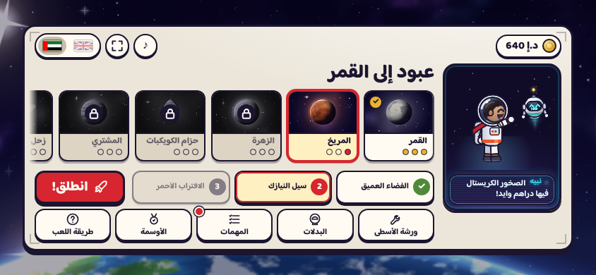
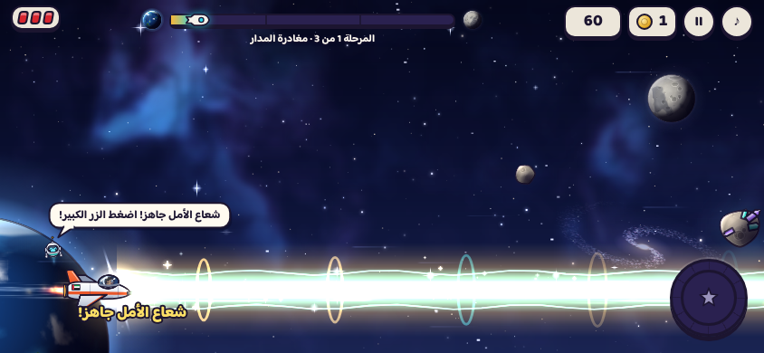

# عبود إلى القمر · Abood to the Moon (v3 · Abood Space)

Sister game to **Run, Abood!**. Abood is grown up now, the youngest astronaut on **Falak Station**, a satellite
station in orbit around Earth. He lives there with his smart AI robot **Nabeeh**, and the hangar robot **Usta**
builds and upgrades his ship. His dream is to fly to the Moon, and then to every planet.

It is a horizontal space shooter in landscape. Arabic is the default language; the flag buttons switch to English.
There are no aliens: the only things in space are rocks, junk left behind in orbit, and sudden meteors.

**Play:** https://mja-py.github.io/abood-space/ (v3) · the original v2 game: https://mja-py.github.io/abood-to-the-moon/




## How to play
- **Move:** drag anywhere on the screen (or the arrows / W A S D). The ship flies up, down, forward and back inside the
  left 40% of the screen.
- **Fire:** automatic. **Graze:** an enemy shot that skims past without touching you charges the beam.
- **Super (the Amal Beam):** the big round button at the bottom right (or Space / X) when its ring is full.
- **Meteors:** a red dashed line and a "!" warn you first, then the meteor charges. Get out of the line.
- **Pause:** II, or P / Esc.

## Fighting (v3.1)
- **Rage robots** appear from Venus on. Each journey teaches one new move on its first leg, alone, while Nabeeh
  explains it, then mixes it with every move learned before. Venus has 1 kind of attack, Neptune has all 6:

  | Journey | New move | Tell |
  |---|---|---|
  | Venus | aimed shot | glowing barrel |
  | Asteroid Belt | charge dash | orange arrows along its lane |
  | Jupiter | area bomb | a red circle where it will land |
  | Saturn | laser sweep | two thin lines: where it starts and ends |
  | Uranus | shield link | a blue cable to a friend (shoot the shielder first) |
  | Neptune | swarm | three homing mini drones |

  Robots fill a rage meter from time and from hits; when it is full they turn red, move faster and attack more often.
  Only a few robots may attack at once (2 at Venus, 4 at Neptune), so it stays readable.
- **Real bosses (v3.3):** every boss fights its own way (`js/bosses.js`). The two guardians of a journey teach a lighter
  version first (guardian A: this journey's trick, guardian B: an earlier one), a title card names the boss, and Nabeeh
  says the trick when the fight starts:

  | Boss | Trick | How to beat it |
  |---|---|---|
  | Moon · Scrappy | a clam shell that shuts | wait until it opens, hit the glowing core; shoot the grey scrap it spits |
  | Mars · Captain Bolt | bouncing bubble bombs | every bubble splits in two; the smallest pop into coins |
  | Venus · Buzzy | the hornet leaves the edge | a dotted path shows its loop through your side; hit it while it perches (×1.5) |
  | Belt · Magna | a magnet that wears scrap | blue pulls scrap into an orbiting armour, red flings it out in a ring |
  | Jupiter · Radar | a searchlight | stay out of the beam or it locks on and snipes; hide behind the drifting rocks |
  | Saturn · Peekaboo | hide and seek | look-alike boxes shuffle; the real one's eye glints; a wrong guess pops a copy |
  | Uranus · Whirly | a spinning armour ring | shoot through the gap; from phase 2 a second ring spins the other way; shots curl |
  | Neptune 1 · Scrap King | a wall of scrap blocks | tunnel through the blocks, shoot the scrap flying in to rebuild it; red blocks shoot |
  | Neptune 2 · Anvil | a hammer on a long arm | leave the red column; after the slam its yellow joint takes double damage |
  | Neptune 3 · Zero | all of it | the spinning ring, then hide and seek, then the hammer |
- **Bosses that think (v3.4):** the tricks above no longer run on a clock. Every boss has a small brain in
  `js/bosses.js`:
  - **It watches you.** Stay in one spot for a few seconds and it says so and goes for that spot. Its shots take
    turns aiming at the ship and ahead of a moving ship, so neither standing still nor one steady slide is safe.
  - **It chooses.** Each boss has three to six moves and picks the next by the situation (Magna flings its armour
    in a ring when you are close and snipes with it when you hang back), never the same move twice running.
  - **It reacts.** Hit it well above the pace of the fight and it defends: Scrappy snaps shut, Captain Bolt hides
    in a bubble, Buzzy jinks out of your lane, Peekaboo blinks away, Whirly turns its thickest plates to you, the
    Scrap King seals your tunnel, Anvil covers its core with the hammer. After it hits you it gloats and gives you a
    breath.
  - **It remembers.** What hit you is kept between fights (localStorage `abood-moon-bossmem-v1`); on a rematch it
    favours that move and says so. Zero runs the three styles that hit this player the most, the worst one last.
  - **You can read it.** A thought bubble over its head shows what it has in mind: dots (thinking), `!` (attack), an
    eye (it noticed a habit), a target (aimed), a shield (defending), `?` (it lost you), a grin (it hit you or
    fooled you), a spiral (dizzy: hit it now).

  | Boss | New moves |
  |---|---|
  | Scrappy | peeks and hides when hit, rolls down your lane and comes back dizzy; knock on the shell and it answers |
  | Captain Bolt | streams small bubbles ahead of you, sucks stray bubbles back from behind, hides in a big bubble |
  | Buzzy | loops through the spot you are in (and may re-aim), stabs down your lane and limps home, strafes |
  | Magna | drags scrap in from BEHIND you (the left edge flashes), snipes, pulls a fresh coat when shot bare |
  | Radar | the beam searches, tracks and loses you (`?`); floodlight, a spotter drone, a blast over your rock, or it shoots the rock away |
  | Peekaboo | keeps score and speeds up; a second tell (the real one sweats when you aim at it); the copies charge when time runs out |
  | Whirly | guards, then must vent; throws the plates facing you as returning saws (leaving a hole there); drags the ship in |
  | Scrap King | rebuilds the hole in your lane first, slides a whole wall in front of you, throws blocks, builds turrets where you like to fly |
  | Anvil | aims ahead and learns which way you run, shifts the column late, sweeps sideways, rains debris, shields its core |
- **Wingmen:** every rescued maintenance robot flies with you, shoots, and blocks one hit (2 at a time, 3 with Nabeeh
  level 5).
- **Supply drones and weapon capsules (v3.3):** three cargo drones cross every leg (and one comes after each boss phase).
  Shoot one open for a capsule that changes weapon every 1.1 s (spread, piercing laser, homing missiles, saws): grab it
  when it shows the one you want. The same weapon again levels it up to 3 (more spread, a wider laser, more missiles and
  saws, more time); another weapon swaps it; a hull hit costs one level. A low hull also gets a repair from the drone.
  Small pickups (cell, rapid, repair, shield) never stay away for long: after about 24 kills without one, one drops.
- **Shot colours (v3.3):** your blaster is electric blue and grows with its level (rails, an arrowhead, a crackling
  edge). Enemy shots are pink with a white core: dodge them. Grey scrap balls can be shot down.
- **Space weather** from Jupiter on: ion storm, dark sector, magnetic field or solar wind (two on the Hard tier).
- **Director:** from Venus on, the pressure rises slowly while you fly clean and eases off after hits, with a build-up
  and relax rhythm. Replays of a finished leg shuffle its waves and set pieces.

## Screens and layout (v3.2)

- **One play-field shape everywhere.** The field is always about 2.15:1, the shape of a phone held sideways. iPads,
  square and 16:9 screens get bands above and below; very wide screens get bands at the sides. Dodging room and the
  time a threat takes to cross are the same on every device. The HUD and the beam button sit in the bands when there is room.
- **Pickups** stay inside the band the ship can reach and last 18 s. Rapid fire lasts 9 s, weapons 14 s (laser 11 s).
- **Reward toasts.** After a leg, level-ups, new journeys, badges and finished missions play one by one over a textured
  backdrop; each moves on by itself and a tap skips it. Choices (wear a new suit or paint, meet Mozah) come last and wait.
  The results card itself keeps only the title, stars, scores, coins and the three buttons; Nabeeh says the next goal.
- **Guided pickers.** Suits (pilot, suit, ship), the hangar and the duel arena share one layout: a live stage with one
  action button, and a fixed row of choices. They fit on a phone in landscape without scrolling.
- **Icons.** Every symbol is an ink line icon in the menu-tile style; no colour emoji.
- Local dev (localhost, 127.0.0.1) never registers the service worker, so edits show on reload.

## Journeys (v3)
Eight journeys of three legs each: Moon → Mars → Venus → Asteroid Belt → Jupiter → Saturn → Uranus → Neptune.
A leg is a scripted flight of about 2½ minutes (`legPlan()` in `js/meta.js` builds it from the journey's flavour and
the leg's tuning row): a calm start that introduces the leg's new thing, a first wave, a scrap-rain breather, a meteor
window, a set piece, a second wave, a twist, a calm, a **WARNING** banner, and the boss. The trip timer freezes while the
boss is on screen; the leg ends when the boss is fixed. Finishing a leg pays dirhams, finishing a whole journey pays a big
arrival bonus, gives you that planet's postcard and fact, and unlocks the next journey. Finished legs can be replayed
for 35% of the reward. If the ship goes down, or you quit, you keep the coins you picked up, but not the leg reward.

- **Bosses inside the journey:** legs 1 and 2 end with a small **guardian** robot (about 20 s). Leg 3 ends with the
  journey's **rogue ship** (Neptune's three legs end with Scrap King, Anvil and Zero). Beating a rogue ship in the journey
  pays its first-win prize and unlocks its costume or paint; the Duels tile stays as a free rematch arena.
- **Easy start, by journey:** the **Moon** is for the youngest pilots: nothing hurts the ship, a hit is only a "bump!",
  targets are slower and bigger, bolts bend towards them, and the boss cannot hurt. **Mars** heals its shield after
  6 s and respawns the ship in place if it goes down. From **Venus** on the hull is real, turrets shoot back, and each
  journey gets faster and denser up to Neptune. A hidden assist kicks in after two deaths on the same leg (slower,
  +1 hull, a shield).
- **Set pieces:** squads of drones that fly in and dive, guard turrets, a grabber that kidnaps Nabeeh (shoot it to free
  him), junk swinging on a tether, solar-panel walls with a gap, a derelict station corridor, a solar flare you shelter
  from behind a big rock, debris cascades, and scrap rain (harmless, all coins).
- **Rescue pods:** three stranded maintenance robots per leg; fly over them to take them along.
- **Ship level gates:** from Venus on, a journey needs a minimum ship level (total upgrade levels: 12, 15, 18, 21, 24, 27).
  Usta tells you what to buy next. A journey you have already started stays open.
- **Leg stars:** each leg has 3 stars: finish it, finish with a healthy hull, and reach the score target.
- **Medals and the Hard tier:** each leg also has 4 medals: finish, no damage at all, every pod rescued, and the score
  target. All 12 medals of a journey open its **Hard** switch next to Launch: faster, tougher, warnings shorter, no
  assists, and replays pay ×2.

## Duels (rematch arena)
After you finish the Mars journey, the **Duels** tile opens with the ten rogue robot ships you meet in the journeys. Each
has its own moves and attacks: aimed shots, fans, walls with a gap, lasers with a warning, homing mines, shields, armour
plates and summoned drones, and phases that change as its health drops. Rematches are free, pay 35%, and one rival a day
pays ×2. A fixed rival becomes a friend of Falak Station (you will see it float round the station).

## Mozah
Abood's sister **Mozah** joins after you finish 10 missions (daily or ladder). Pick who flies at the top of the
Costumes sheet. She has her own suit colours, a sports hijab inside her helmet, and the Arabic text speaks to her in the feminine.

## Missions
- **Mission ladder:** endless sets of three missions, like Run, Abood!. Each finished set raises the coin multiplier by ×0.1
  (up to ×2.5) and pays a reward. A stuck mission can be skipped for dirhams.
- **Daily missions:** three a day. The rewards grow as you reach further planets.
- **Login gift:** 7 days, with a booster on day 7 and a welcome-back gift after a few days away.

## Hangar (Usta's upgrades), boosters and costumes
- **Upgrades:** blaster, twin guns (up to 5 bolts), hull armour, shield, super core, engine, magnet and **Nabeeh AI**.
  From level 1 Nabeeh shoots with his own laser, from level 3 he pulls in coins, and at level 5 he fires double.
  The top level of most upgrades adds a small extra trick. As you upgrade, the ship's look changes through 5 tiers.
- **Boosters:** start shield, start beam, +1 hull and +0.5 coins, bought in the hangar and armed before a flight.
- **Costumes:** free colours for each character, plus 12 costumes with a small effect and their own engine trail, bolt
  colour or glow, for example the magnet suit (wider magnet), the comet suit (faster moves), the ice suit
  (meteors warn earlier) and the champion suit (from beating the last rival). They come from dirhams, badges, rivals,
  the mission ladder and leg stars.
- **Ship paints:** 7 paint jobs, won from rivals and badges.
- **Badges:** bronze, silver and gold tiers, plus one-off badges.

The economy is sized for about two months of daily play (15–20 minutes a day) to win everything.

## Files
```
index.html  css/style.css     page, HUD, menus (Falak Station)
js/game.js                    loop, gameplay, particles, sound (ZzFX + Hijaz music)
js/art.js                     all drawing: space, planets, ship, Abood, Nabeeh, Usta, rocks, junk, meteors
js/ui.js                      menus, hangar, suits, missions, badges, results, HUD
js/meta.js                    save, journeys, leg plans (timelines), assist profiles, guardians, economy, upgrades, missions, badges
js/bosses.js                  the boss brain (senses, move choice, memory, thought bubble) and the nine boss styles
js/pieces.js                  drawing for the set pieces: turrets, grabber, tether, station walls, rescue pods, solar flare
js/i18n.js                    Arabic + English text
sw.js, manifest.webmanifest   offline + install (landscape, fullscreen)
```
Run locally:

```bash
python3 -m http.server 8000
```

Then open http://localhost:8000.

Publishing: `./deploy.sh` stamps the commit id into every `__BUILD__` (cache names and asset URLs), builds the site into
an orphan `gh-pages` branch and force-pushes it. GitHub Pages serves that branch (**Settings → Pages**, source
**Deploy from a branch**, branch **gh-pages**, folder **/ (root)**). The original repo did the same from a workflow on every
push; this repo keeps it as a script because pushing workflow files needs a token with the `workflow` scope.

See [CREDITS.md](CREDITS.md) for third-party licences.

## Testing from the console
`window.__game.debug` drives the engine without playing: `start('venus', 1)`, `step(1/60, 600)` advances the simulation
without animation frames, `jump(120)` moves the leg clock, `skip()` jumps to the WARNING (or ends the boss on screen),
`piece('corridor')` fires any set piece (`wall squad turrets tether pods scrapRain cascade flare corridor grabber`),
`winDuel()` fixes the boss, `beats()` lists the leg's timeline, `info()` shows the run. v3.1 adds `robot({ atk:['bomb'] })`,
`weapon('saw')`, `wing()`, `combat()` (robots, zones, tokens), `killPart('shieldGen')`, `setXY(x, y)` and `rival()` with parts and guards. v3.3 adds `bs()` (the styled boss: style, mode, targets, HP),
`hitBoss(n)`, `carrier()`, `picks()` and `wpn()`. v3.4 adds `brain()` (what the boss senses and plans), `bossMove('dart')` (force a move) and
`bossMem()` (its memory of earlier fights; `bossMem(null)` clears it).
